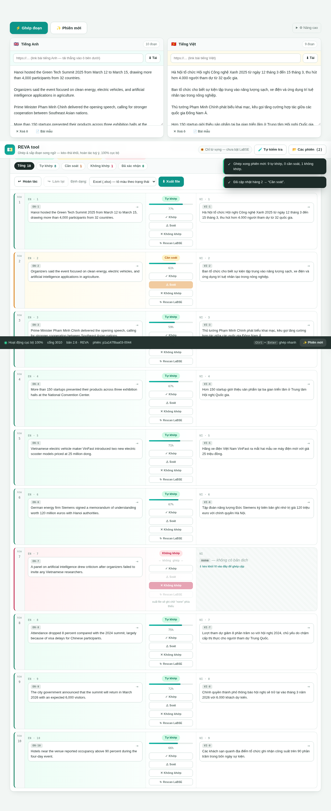
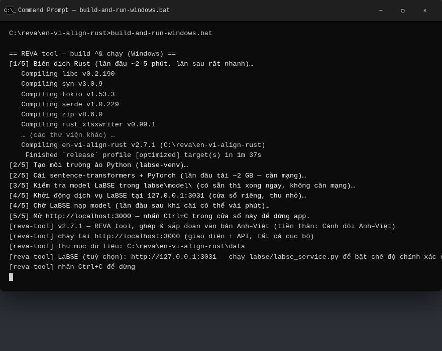
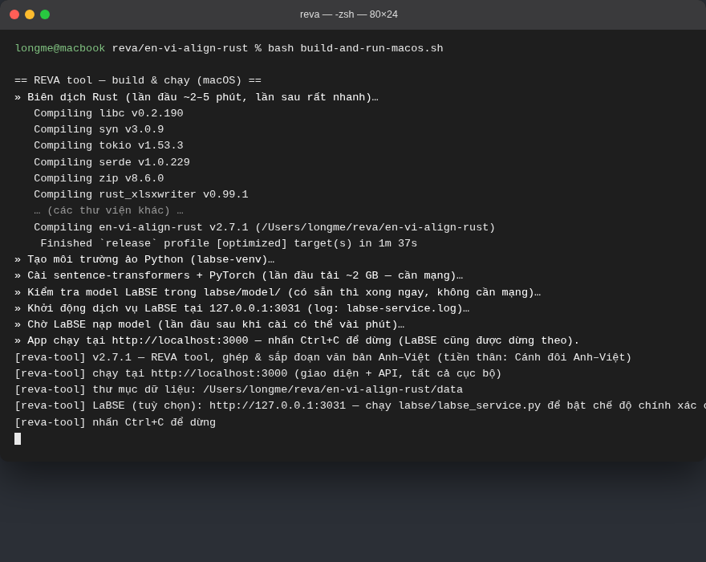
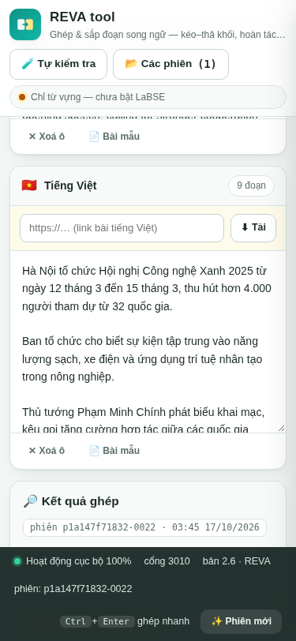
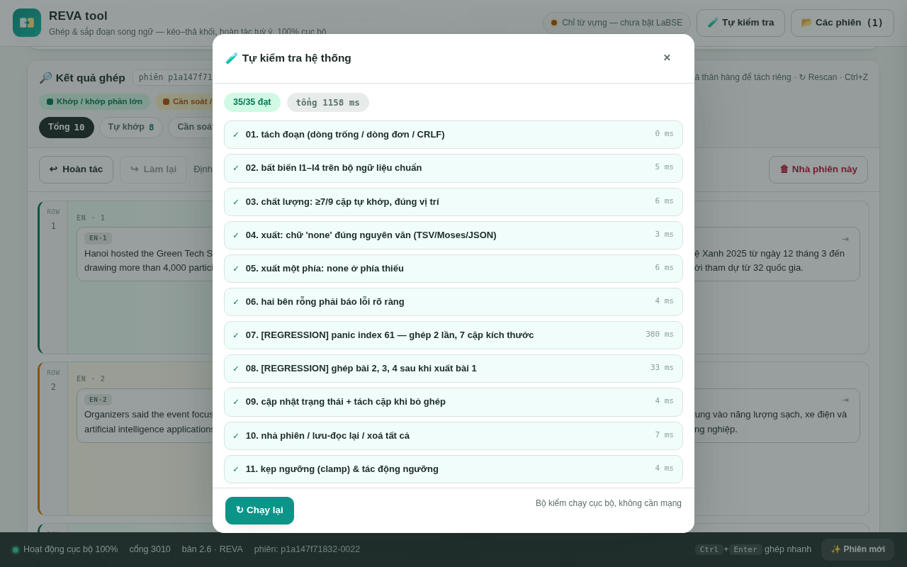

# REVA — công cụ ghép đoạn song ngữ Anh–Việt



**REVA** giúp bạn đi tìm *"đoạn tiếng Anh này tương ứng với đoạn tiếng Việt nào"* giữa một bài gốc và bản dịch — rồi xuất ra **bảng đối chiếu Excel/CSV/HTML…** để soát dịch. REVA **không dịch** — chỉ ghép và sắp xếp.

- 🏠 **Chạy 100% trên máy bạn** — văn bản của bạn không bị gửi lên Internet đâu cả.
- 🖱️ **Kéo–thả từng đoạn** để sắp xếp lại; làm sai thì **Ctrl+Z hoàn tác ngay**.
- 🎨 **Xuất Excel tự tô màu**: <span>🟩</span> xanh = khớp · 🟨 vàng = cần soát · 🩷 hồng = không khớp.

> Dùng tốt cho: biên dịch viên, dịch giả sách/truyện, đội dịch nội dung, người học dịch — bất kỳ ai có **2 văn bản song ngữ** cần ghép cặp từng đoạn.

---

## Mục lục

1. [Bạn cần cài gì? (chỉ 2 phần mềm)](#1-bạn-cần-cài-gì-chỉ-2-phần-mềm)
2. [Cài đặt từng bước — Windows](#2-cài-đặt-từng-bước--windows)
3. [Cài đặt từng bước — macOS](#3-cài-đặt-từng-bước--macos)
4. [Chạy REVA](#4-chạy-reva)
5. [Khi làm đúng bạn sẽ thấy gì?](#5-khi-làm-đúng-bạn-sẽ-thấy-gì)
6. [Chạy lại lần sau (rất nhanh)](#6-chạy-lại-lần-sau-rất-nhanh)
7. [Câu hỏi thường gặp](#7-câu-hỏi-thường-gặp)
8. [Tính năng chính](#8-tính-năng-chính)
9. [Cho người phát triển](#9-cho-người-phát-triển)

---

## 1. Bạn cần cài gì? (chỉ 2 phần mềm)

| Phần mềm | Bắt buộc? | Để làm gì | Dung lượng |
|---|---|---|---|
| **Rust** (bộ công cụ biên dịch) | ✅ **Bắt buộc** | Biên dịch REVA thành chương trình chạy được | ~1,5 GB (Windows cần thêm *Visual Studio C++ Build Tools* ~6 GB) |
| **Python 3** | 🔶 Tuỳ chọn *(rất khuyên dùng)* | Chạy **LaBSE** — chế độ ghép chính xác cao hơn | ~150 MB |

**Sau đó bạn KHÔNG phải cài thêm gì thủ công nữa.** File lệnh chạy REVA sẽ tự làm các việc còn lại lần đầu tiên:

- tạo môi trường Python riêng cho REVA (`labse-venv`) — không đụng vào Python của máy bạn;
- tải PyTorch + sentence-transformers (~2 GB, **chỉ lần đầu**);
- tải model LaBSE (~2 GB, **chỉ đúng 1 lần**, lưu trong thư mục `labse/model/` — về sau build lại mã nguồn bao nhiêu lần cũng **không bao giờ tải lại**).

**Tổng dung lượng cần chuẩn bị: ~6 GB** (Windows: ~12 GB tính cả Visual Studio Build Tools).
**Không muốn cài Python?** REVA vẫn chạy được bình thường — xem mục [FAQ](#7-câu-hỏi-thường-gặp). LaBSE chỉ là *tuỳ chọn nâng độ chính xác*.

---

## 2. Cài đặt từng bước — Windows

### Bước 0 — Tải mã nguồn REVA

Vào trang [**Releases**](https://github.com/longme179/Rust-Eng-Vie-Aligner-tool/releases) của repo → tìm bản mới nhất → tải file **`en-vi-align-rust-source-vX.Y.zip`** → giải nén ra một thư mục dễ nhớ, ví dụ `C:\reva\en-vi-align-rust`.

### Bước 1 — Cài Rust

1. Mở trình duyệt, vào **https://rustup.rs** → tải file **`rustup-init.exe`**.
2. Chạy file đó. Nếu Windows hiện bảng xanh *"Windows protected your PC"* → bấm **More info** → **Run anyway** (bình thường với phần mềm mã nguồn mở chưa kí số).
3. Trong cửa sổ đen hiện ra, nó sẽ hỏi chọn `1` / `2` / `3` → **gõ `1` rồi Enter** (cài mặc định).
4. Nếu nó báo *"Visual Studio C++ Build Tools is required"* → trả lời **`y`** + Enter, làm theo màn hình installer hiện ra:
   - giữ nguyên lựa chọn **"Desktop development with C++"** (không cần tick thêm gì) → bấm **Install** → chờ xong (tải ~6 GB).
5. Cài xong Rust: **đóng hết cửa sổ đen, MỞ CỬA SỔ MỚI** (quan trọng — để Rust nhận đường dẫn).

### Bước 2 — Cài Python (nếu muốn LaBSE chính xác cao)

1. Vào **https://www.python.org/downloads/** → tải bản **Windows installer (64-bit)**.
2. Chạy file cài: **CỰC KỲ QUAN TRỌNG** — ở màn hình đầu tiên, **TICK vào ô "Add python.exe to PATH"** trước khi bấm Install Now.
3. Xong. Không cần mở Python làm gì cả — chỉ cần nó nằm trong máy.

### Bước 3 — Chạy

Vào thư mục giải nén lúc nãy (**`en-vi-align-rust`**) → **nháy đúp file `build-and-run-windows.bat`** → xong. Đợi lần đầu ~10–20 phút (xem FAQ). Xem [mục 5](#5-khi-làm-đúng-bạn-sẽ-thấy-gì) để biết bạn sẽ thấy gì.

---

## 3. Cài đặt từng bước — macOS

### Bước 0 — Tải mã nguồn REVA

Vào trang [**Releases**](https://github.com/longme179/Rust-Eng-Vie-Aligner-tool/releases) → tải **`en-vi-align-rust-source-vX.Y.zip`** → giải nén, ví dụ vào `~/reva/en-vi-align-rust`.

### Bước 1 — Cài Rust

1. Mở ứng dụng **Terminal**: nhấn `⌘ Command + Space` → gõ `Terminal` → Enter.
2. Dán lệnh sau vào Terminal rồi Enter (lệnh chính thức từ trang **https://rustup.rs**):

   ```bash
   curl --proto '=https' --tlsv1.2 -sSf https://sh.rustup.rs | sh
   ```

3. Khi nó hỏi `1) Proceed with installation (default)` → **Enter** (chọn 1).
4. Nếu macOS bật cửa sổ hỏi cài **"Command Line Tools"** → bấm **Install** và chờ (đây là bộ biên dịch mà Rust cần).
5. Cài xong, chạy đúng 1 lệnh để Terminal nhận Rust:

   ```bash
   source ~/.cargo/env
   ```

### Bước 2 — Cài Python (nếu muốn LaBSE chính xác cao)

- Cách dễ nhất: vào **https://www.python.org/downloads/macos/** → tải bản **macOS 64-bit universal2 installer** → cài như ứng dụng bình thường (nhấn Continue → Agree → Install).

### Bước 3 — Chạy

1. Trong **Terminal**, gõ `bash` **+ một dấu cách**.
2. Mở Finder, tìm file **`build-and-run-macos.sh`** trong thư mục giải nén → **kéo thả file đó vào cửa sổ Terminal** (Terminal tự điền đầy đủ đường dẫn).
3. Nhấn **Enter** → đợi lần đầu ~10–20 phút. Xem [mục 5](#5-khi-làm-đúng-bạn-sẽ-thấy-gì).

---

## 4. Chạy REVA

Tóm lại, sau khi cài đủ 2 phần mềm trên, bạn chỉ cần **một thao duy nhất mỗi lần muốn dùng REVA**:

| Hệ điều hành | Cách chạy |
|---|---|
| **Windows** | Nháy đúp `build-and-run-windows.bat` trong thư mục `en-vi-align-rust` |
| **macOS** | Terminal → gõ `bash ` → kéo file `build-and-run-macos.sh` vào → Enter |

File lệnh này TỰ LÀM 5 việc: biên dịch app → chuẩn bị Python/LaBSE (bỏ qua phần đã có) → khởi động LaBSE → chạy app → mở sẵn trình duyệt tại **http://localhost:3000**.

> **"Terminal" là gì?** — Terminal (Windows gọi là CMD/PowerShell) là cửa sổ gõ lệnh chữ đen. Bạn không cần biết lập trình — chỉ cần dán đúng lệnh được chỉ và bấm Enter. Đừng đóng cửa sổ này khi đang dùng REVA (đó là app đang chạy đó!). Tắt app = trở lại cửa sổ, nhấn **Ctrl+C** (giữ phím Ctrl, gõ chữ C).

---

## 5. Khi làm đúng bạn sẽ thấy gì?

### Cửa sổ Terminal trông như thế này

**Windows** (`build-and-run-windows.bat`):



**macOS** (`build-and-run-macos.sh`):



*(Ảnh minh hoạ — thời gian biên dịch và đường dẫn trên máy bạn sẽ khác nhau.)*

Dấu hiệu **làm đúng**: thấy dòng `[reva-tool] chạy tại http://localhost:3000` và cửa sổ **không tự đóng** — nó cứ đứng yên như thế là app đang chạy. Trình duyệt sẽ tự mở; nếu không thì tự mở `http://localhost:3000`.

### Trình duyệt mở ra giao diện REVA

Đây là màn hình chính sau khi bấm nút **📄 Bài mẫu** rồi **⚡ Ghép đoạn** (mỗi hàng = một cặp Anh–Việt đã ghép):


- 🟩 hàng **xanh** = khớp (tự khớp hoặc bạn đã bấm ✓) — 🟨 hàng **vàng** = cần soát — 🩷 hàng **hồng** = không khớp (thiếu một phía).
- Mỗi đoạn là **một khối 🧩**: kéo sang hàng khác, đổi thứ tự, tách riêng; Ctrl+Z hoàn tác.
- Xuất file bằng nút **⬇ Xuất file** — chọn **Excel (.xlsx)** để có sẵn màu trong file.

REVA cũng chạy tốt trên điện thoại/máy tính bảng nếu mở `http://localhost:3000` trên chính máy đó:



### Muốn kiểm tra máy mình cài đúng chưa?

Bấm nút **🧪 Tự kiểm tra** trên góc phải — nếu mọi bài đều ✓ (35/35) là REVA chạy hoàn hảo trên máy bạn:



---

## 6. Chạy lại lần sau (rất nhanh)

Lần **đầu** mất ~10–20 phút (biên dịch + tải model 1 lần duy nhất). Từ lần **thứ hai** trở đi chỉ **~30 giây**: chạy lại đúng file lệnh đó — nó nhận ra mọi thứ đã cài sẵn và bỏ qua.

## Cập nhật lên bản REVA mới

1. Tải zip bản mới từ [Releases](https://github.com/longme179/Rust-Eng-Vie-Aligner-tool/releases) → giải nén **sang thư mục mới**.
2. Chép 2 thư mục sau từ thư mục CŨ sang thư mục MỚI (để **không phải tải lại ~4 GB**):
   - `labse/model/` — model LaBSE đã tải;
   - `labse-venv/` — môi trường Python đã cài (Windows: thư mục `labse-venv`).
3. Chạy file lệnh trong thư mục mới như bình thường.

---

## 7. Câu hỏi thường gặp

**❓ Không muốn cài Python / máy yếu / thiếu chỗ trống — vẫn dùng được không?**
Được. Sau khi chạy `build-and-run-*.bat|sh` ít nhất 1 lần (để app được biên dịch), nếu script dừng ở bước Python, bạn vẫn chạy được app không LaBSE:
- Windows: mở CMD trong thư mục `en-vi-align-rust` rồi gõ `target\release\reva-tool.exe`
- macOS: trong Terminal gõ `./target/release/reva-tool`
App báo *"Chỉ từ vựng — chưa bật LaBSE"* — ghép vẫn chạy 100%, chỉ kém chính xác hơn với văn bản ít số liệu/tên riêng.

**❓ Văn bản của tôi có bị gửi lên mạng không?**
Không. REVA chạy hoàn toàn trên máy bạn. Mạng chỉ được dùng khi: (1) lần đầu cài/tải model, (2) khi bạn chủ động dùng tính năng "⬇ Tải" từ một URL bài viết.

**❓ Lần đầu chạy lâu cỡ nào, cần bao nhiêu GB?**
Lần đầu ~10–20 phút tuỳ mạng (biên dịch Rust 2–5 phút + tải ~4 GB các gói/model). Từ lần 2: ~30 giây. Tổng dung lượng sau khi cài hết: ~6 GB (Windows ~12 GB vì kèm Visual Studio Build Tools).

**❓ Cửa sổ đen tắt ngay / báo lỗi?**
Chụp màn hình lỗi lại rồi xem: thường là (1) chưa cài Rust — cài rồi **chưa mở cửa sổ mới** (phải mở CMD/Terminal MỚI sau khi cài Rust); (2) Windows chưa có Visual Studio C++ Build Tools (xem Bước 1); (3) thiếu chỗ trống đĩa (~6 GB).

**❓ Nút nào để dừng REVA?**
Về cửa sổ Terminal đang chạy app, nhấn **Ctrl+C** (giữ Ctrl, gõ C). Windows: cửa sổ LaBSE thu nhỏ ở thanh tác vụ cũng nên đóng nếu muốn dừng hẳn.

**❓ "Add python.exe to PATH" tôi quên tick?**
Gỡ Python (Settings → Apps) rồi cài lại, tick đúng ô đó lần này.

**❓ File Excel .xlsx xuất ra mở lên có màu thật không?**
Có — mỗi hàng được tô sẵn màu nền xanh/vàng/hồng nhạt kèm cột "Điểm (%)" và "Trạng thái". CSV/TSV là định dạng văn bản thuần nên không mang màu được — muốn màu, chọn Excel (.xlsx).

**❓ REVA có dịch hộ tôi không?**
Không. REVA chỉ *ghép & sắp xếp* các đoạn đã có sẵn của hai văn bản. Bạn vẫn cần bản dịch (tự dịch hoặc từ dịch giả/máy dịch).

**❓ LaBSE là gì, tại sao nên cài?**
LaBSE là model hiểu nghĩa câu của Google chạy ngay trên máy bạn. Bộ từ vựng sẵn có của REVA giỏi với bài báo giàu số liệu/tên riêng; LaBSE giỏi mọi loại văn bản vì "hiểu nghĩa" — nhờ vậy các cặp dịch thoáng, lược bớt đoạn vẫn ghép đúng.

---

## 8. Tính năng chính

- **Ghép đoạn song ngữ** bằng điểm tương đồng (từ điển Anh–Việt ~500 mục, số liệu, tên riêng, vị trí tương đối) + quy hoạch động — không cần GPU.
- **LaBSE tuỳ chọn**: hoà trộn điểm từ vựng với cosine LaBSE (nguyên tắc *chỉ nâng không hạ*) → chính xác hơn hẳn.
- **Mô hình khối kéo–thả tự do**: mỗi đoạn là một khối; kéo ghép/tách/đổi thứ tự; **Ctrl+Z hoàn tác 40 bước**; `↻ Rescan LaBSE` chấm lại điểm từng hàng.
- **4 trạng thái chuẩn**: Tự khớp · Cần soát · Không khớp · Đã xác nhận — hiển thị bằng màu trong giao diện lẫn file xuất.
- **Xuất 7 định dạng**: Excel `.xlsx` (tự tô màu từng hàng), CSV, TSV, Moses, JSON, HTML (bảng có màu), XLIFF 1.2 (cho công cụ CAT). Đoạn thiếu một phía ghi đúng chữ `none`.
- **Tải bài từ URL**: dán link bài báo tiếng Anh/tiếng Việt — REVA tự trích nội dung, lọc sạch menu/quảng cáo/caption ảnh.
- **Phiên làm việc độc lập**: ghép bao nhiêu bài liên tiếp không lẫn dữ liệu; tự lưu vào `data/sessions/`, mở lại được.
- **35 bài tự kiểm** nội bộ (hồi quy lỗi từng gặp + tích hợp LaBSE + Excel màu) — bấm 🧪 Tự kiểm tra bất cứ lúc nào.

Chi tiết thuật toán, API HTTP, cấu trúc mã nguồn, bất biến kiểm chứng và lịch sử các bản: xem **[docs/README-KY-THUAT.md](docs/README-KY-THUAT.md)**.

---

## 9. Cho người phát triển

REVA là một binary Rust duy nhất (axum + tokio) nhúng sẵn giao diện, kèm dịch vụ LaBSE Python tuỳ chọn tại `127.0.0.1:3031`.

```bash
cargo run --release        # build + chạy tại http://localhost:3000
cargo test                 # 35 bài selftest
```

Đổi cổng: `PORT=1709 cargo run --release`. Đổi thư mục dữ liệu: `REVA_DATA_DIR=...`. Xem đầy đủ API + tài liệu kỹ thuật tại **[docs/README-KY-THUAT.md](docs/README-KY-THUAT.md)**.

## Giấy phép

MIT — xem `LICENSE`.
